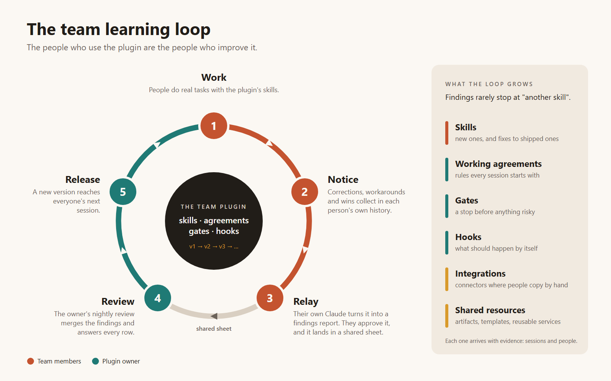
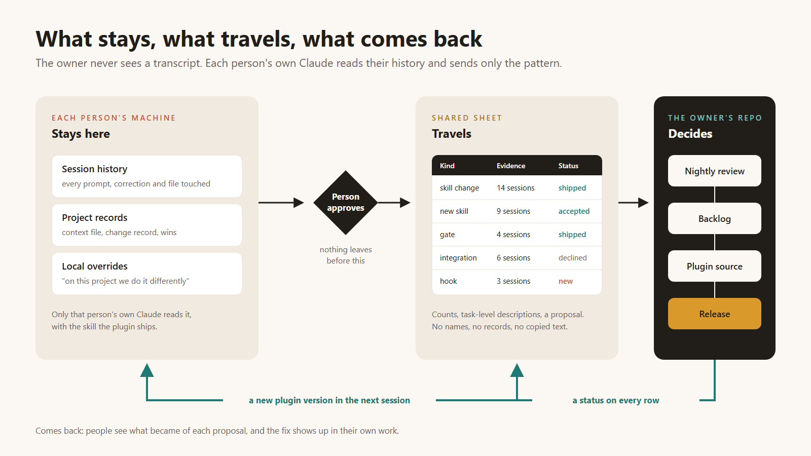
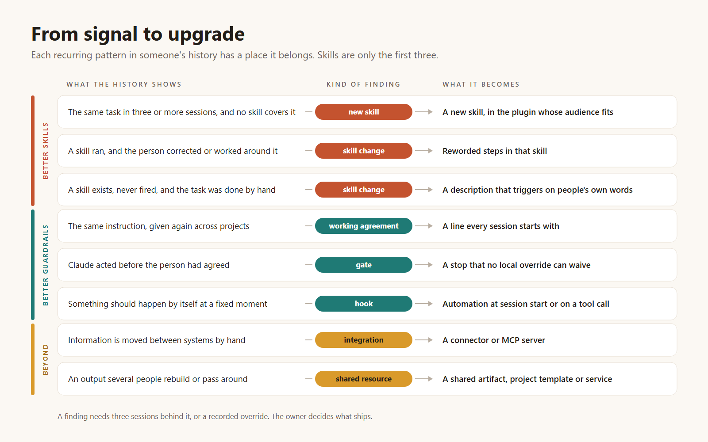

# Team loop

A starter kit for a Claude team plugin that improves from its own use. Your colleagues work with
the plugin, their own Claude reports what keeps recurring, and the owner's scheduled review turns
those reports into the next version.



It is for whoever looks after Claude for a team on a Team or Enterprise plan, in any line of
work. The kit holds a working plugin, the owner's review skill, the intake layout and a setup
guide that a Claude Code session can follow with you. It comes from a setup in use at a
consultancy; the article in [`writeup/`](writeup/writeup.md) tells that story in a page.

## What is in the kit

| Part | What it is | For |
|---|---|---|
| [`plugins/team-loop/`](plugins/team-loop/) | a plugin with six skills, working agreements and a session-start hook | every member, in chat, Cowork and Claude Code |
| [`.claude/skills/review-findings/`](.claude/skills/review-findings/SKILL.md) | the review that merges what the team sent in and drafts the changes | the owner, by hand or on a schedule |
| [`docs/setup.md`](docs/setup.md) | eight steps from copying the kit to the owner's morning routine | the owner and their Claude |
| [`docs/how-it-works.md`](docs/how-it-works.md) | the design, the reason for each decision, the platform facts it rests on | anyone adapting it |
| [`docs/backlog.md`](docs/backlog.md) | where evidence and candidates accumulate | the review and the owner |
| [`tools/`](tools/) | build the upload zip; print the plugin catalogue for the intake sheet | releasing |
| [`writeup/`](writeup/) | the article and three visuals | explaining it to others |

## The plugin's skills

| Skill | Someone says | It does |
|---|---|---|
| [`catch-up`](plugins/team-loop/skills/catch-up/SKILL.md) | "pick up where we left off" | reads the project's records, checks them against the live state, reports where things stand |
| [`close-out`](plugins/team-loop/skills/close-out/SKILL.md) | "wrap up" | updates the change record and context file, notes a win when one is mentioned, leaves a handoff |
| [`setup-project-context`](plugins/team-loop/skills/setup-project-context/SKILL.md) | "set up Claude for this project" | creates the context file and change record every later session starts from |
| [`write-update`](plugins/team-loop/skills/write-update/SKILL.md) | "write an update for the customer" | drafts a short message from verified facts and shows it before anything is sent |
| [`adapt-skill`](plugins/team-loop/skills/adapt-skill/SKILL.md) | "here we do it differently", "the skill got this wrong" | records a project override that survives updates, and drafts a note for the owner |
| [`ideas`](plugins/team-loop/skills/ideas/SKILL.md) | "find skill ideas" | reads the person's own Claude history, compares it with the team's plugins, writes a findings report |

The first four are the daily work. The last two are the loop: they are how use turns into
evidence. Every skill reads a project's `.claude/team-overrides.md` before it starts, and a step
marked `Gate:` waits for the person whatever an override says.

## Try it

In Claude Code:

```
claude plugin marketplace add sevenevesai/claude-team-loop
claude plugin install team-loop@team-loop-kit
```

Start a new session and ask it to "find skill ideas". It tells you what it will read, scans your
own session history on your computer, and shows you a report. Nothing is sent anywhere: the kit's
intake link is not set, so the report stays a local file.

A plugin's skills and hooks run with your session's permissions. Read
[`hooks/hooks.json`](plugins/team-loop/hooks/hooks.json) and the skills before installing, as
with any plugin.

## Set it up for your team

Trying the plugin shows one station. The loop needs your own copy, because the plugin has to
carry your team's agreements and point at your team's intake.

1. Create a private repository from this one.
2. Rename the `team` prefix and write in your own working agreements and gates.
3. Create the intake sheet and paste its link into the plugin.
4. Trial a skill, then publish the plugin to your organisation.
5. Tell the team three sentences.
6. Schedule the review.

[`docs/setup.md`](docs/setup.md) has each step with its success signal. Or open your copy in
Claude Code and say:

> Read CLAUDE.md and docs/setup.md, ask me the opening questions, then set this up for my team.

## How the loop works



The owner never sees a transcript. `ideas` runs in each member's own session, codes their history
into task types and counts, and writes a report with no names, ids or copied text. The member
reads it and approves it, and only then does it reach the shared sheet. The owner's review
answers every row with a status, so people see what became of what they sent.



A finding has a kind, and the kind says where it lands. Three kinds improve skills. Three
tighten guardrails: working agreements, gates, hooks. Two point beyond the plugin, at a
connector or at a shared artifact, template or service. The reasons behind each choice are in
[`docs/how-it-works.md`](docs/how-it-works.md).

## For AI agents

- Start with [`CLAUDE.md`](CLAUDE.md): layout, commands with their success signals, invariants.
- To set the kit up for someone, follow [`docs/setup.md`](docs/setup.md) in order. Ask its five
  opening questions first; they are the person's decisions.
- `claude plugin validate . --strict` and `claude plugin validate plugins/team-loop --strict`
  print "Validation passed" and exit 0.
- `python tools/package-plugins.py team-loop` prints the zip path, file count and size, and exits
  1 when that version already has a zip.
- `python tools/plugin-catalogue.py --published team-loop` prints a JSON array of rows, header
  first, for the sheet's Plugins tab.
- The report format and the sheet's columns are in
  [`report-format.md`](plugins/team-loop/skills/ideas/references/report-format.md) and
  [`intake.md`](plugins/team-loop/skills/ideas/references/intake.md).

## Status

- The plugin is a generic port of a plugin set in use on a Claude Team plan. The port passes
  both validate commands. Its skills have not been trialled again since the port, so give each
  one a trial (setup step 4) before you publish your copy.
- `review-findings` is new in this kit. It has not yet run on a schedule.
- What was not verified, such as a member's Claude writing to a sheet someone else owns, is
  listed at the end of [`docs/how-it-works.md`](docs/how-it-works.md). Each has a fallback.

## Layout

```
.claude-plugin/marketplace.json     lists the plugins
plugins/team-loop/                  the plugin: skills, context, hooks
.claude/skills/review-findings/     the owner's review skill
.claude/rules/plugin-authoring.md   the standard for plugin skills
docs/                               setup, design, backlog
tools/                              packaging and catalogue scripts
writeup/                            the article and visuals
```
