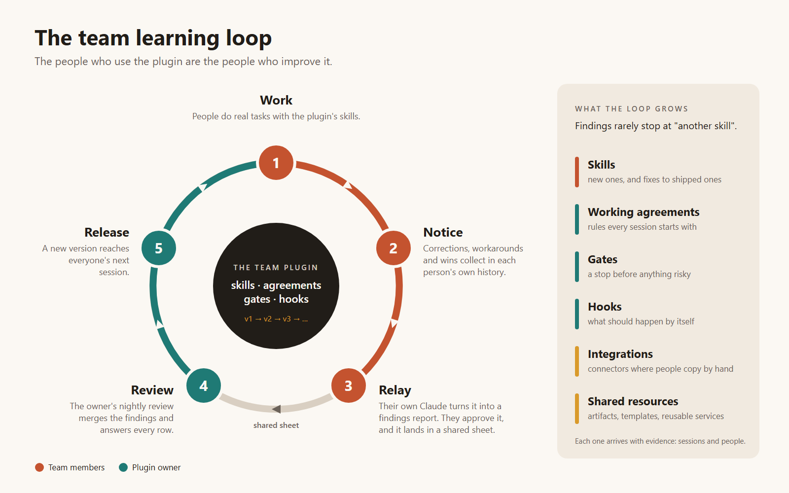
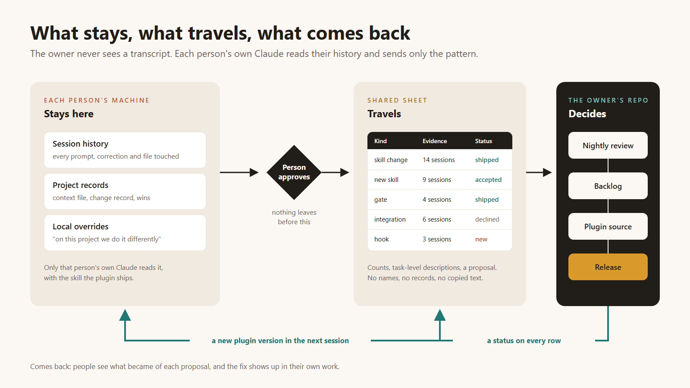
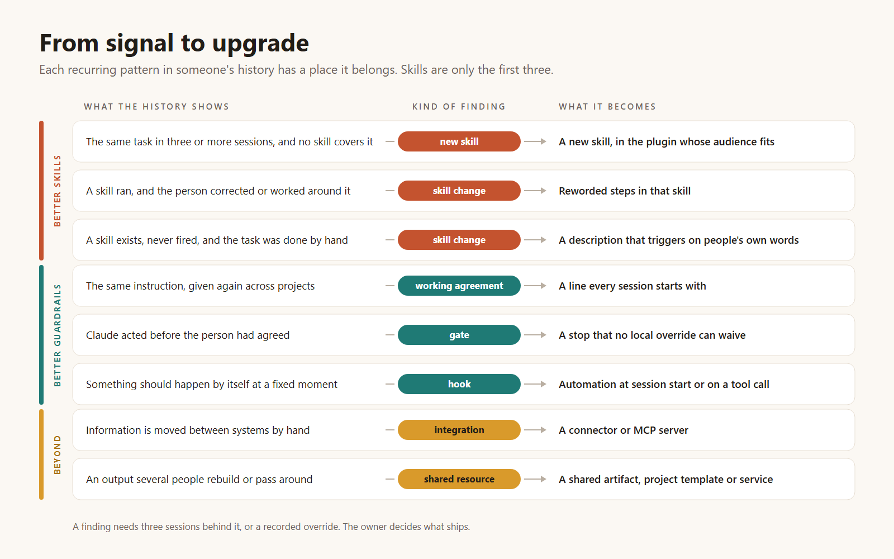

# How the loop works

The design, and the reason for each decision. Setup steps are in `setup.md`.

## Roles

- A member uses Claude for their own work, in chat, Cowork or Claude Code. Most are not
  developers and should not need to learn what a skill is.
- The owner maintains the plugins in a private copy of this repository and decides what ships.
  The owner needs Claude Code; nobody else does. The plugin's own text says "the maintainers",
  since a team may have more than one.

## Three layers

| Layer | Holds | Travels as | Kept current by |
|---|---|---|---|
| Team | how the team works, platform skills, safety agreements | plugins built from this repository | the owner |
| Project | project facts, environments, readers, history, local adjustments | a context file and change record in the project folder, or a shared Claude Project; `.claude/team-overrides.md` | each member's own sessions, through `setup-project-context`, `close-out` and `adapt-skill` |
| Repository | code and configuration | the project's own repository | its developers |

## The loop, station by station

1. Work. Members do real tasks with the plugin's skills. `catch-up` starts resumed work from the
   project's records, `close-out` brings the records up to date, `write-update` drafts what
   someone else will read.
2. Notice. Nobody logs anything. Corrections and repeated instructions are already in each
   person's session history. `close-out` adds a `Win:` line to the change record when the person
   mentions a saving. `adapt-skill` writes an override when a default does not fit a project.
3. Relay. `ideas` has the person's own Claude code their history, compare it with every team
   plugin and write a findings report. After the person approves it, the report goes to the
   shared sheet as rows. `adapt-skill` sends a single note the same way.
4. Review. `review-findings` runs in the owner's repository, by hand or on a schedule. It merges
   new rows into `backlog.md`, drafts the changes the evidence justifies on a branch, and sets a
   status on every row.
5. Release. The owner reviews the branch, bumps the version and publishes. Members get the new
   version, and the row that asked for it reads `shipped`.

## Decisions

### Skills carry the value; hooks only repeat it

Plugin skills load in chat, Cowork and Claude Code. Hooks and agents are ignored in chat. So a
step that protects a system is written into the skill as a line starting `Gate:`, and the
session-start hook only repeats the working agreements where hooks run.

### Standing agreements come from a session-start hook

A plugin cannot ship a `CLAUDE.md` or rules. The plugin prints `context/working-agreements.md`
at session start instead. Keep that file short and ASCII: it is added to every session.

### A project adapts a skill through an overrides file

Installed plugin files are replaced on every update and members cannot edit them. Local practice
goes into `.claude/team-overrides.md`, which every skill reads before it starts. An override
cannot waive a gate. A section that grows past ten lines is a signal for the owner, and
`adapt-skill` sends it.

### Record upkeep is something the skills do

`catch-up` and `close-out` keep the context file and change record current, so the next session
starts informed and the person never maintains documents by hand. Those records are also where
wins and overrides accumulate as evidence.

### Each person's own Claude reads their history

On a Team plan the owner has no view of members' sessions, and collecting transcripts would move
confidential text off members' machines. A member's own Claude already has the access. It codes
the history bottom-up before looking at the plugin list, because a scan that starts from the
list finds what it expects. Only counts and task-level descriptions leave, in a fixed format,
after the person has read them.

### One intake for every plugin, with a catalogue

`ideas` and `adapt-skill` live in the plugin everyone has and serve all team plugins. The sheet's
Plugins tab lists every plugin and skill, generated by `tools/plugin-catalogue.py` at each
release. That lets `ideas` report "not installed" findings and aim a finding at a plugin the
person does not have, and a new plugin needs no change to the skill.

### A finding has a kind, and the kind says where it lands

New skill, skill change, not installed, working agreement, gate, hook, integration, shared
resource, other. The last three point outside the plugin: at a connector, a shared artifact, a
project template or a service several teams could reuse. The review records those in the backlog
and builds none of them.

### The review drafts; the owner releases

A scheduled run can read, count, merge and draft without anyone present. Merging the branch and
publishing change what every colleague's session does, so `review-findings` stops before both.

### One plugin per audience or platform

Skill listings share a small part of the context window, and safety rules differ by platform.
`team-loop` is for everyone; a platform's skills go in their own `team-<platform>` plugin.

### Distribution on member rights

On a Team plan a member can upload a plugin and publish it to the organisation, unless an Owner
changed the publishing setting. The loop therefore needs no admin role. An Owner can instead
sync a private repository to the organisation; the layout here (`.claude-plugin/marketplace.json`
with relative sources) fits that route too.

## Platform facts this rests on

Read from Anthropic's documentation on 2026-11-19. Products change: check a fact again before a
decision depends on it.

| Fact | Source |
|---|---|
| Plugin skills load in chat, Cowork and Claude Code; hooks and agents do not load in chat; a plugin with a top-level `bin/` cannot be installed on claude.ai | <https://claude.com/docs/plugins/platform-support> |
| A member can upload a plugin, share it with named people or publish it to the organisation | <https://claude.com/docs/plugins/share> |
| Organisation-wide plugin settings and GitHub sync belong to Owners | <https://claude.com/docs/plugins/admin>, <https://claude.com/docs/plugins/org-sync> |
| A plugin's `version` decides whether users get an update; installed copies are replaced on update | <https://code.claude.com/docs/en/plugins/loading> |
| A session-start hook's output is added before the first prompt | <https://code.claude.com/docs/en/hooks> |
| Skill descriptions are always listed and share a limited budget | <https://code.claude.com/docs/en/skills> |
| Claude Code keeps session transcripts on the person's computer and deletes them after `cleanupPeriodDays` (default 30) | <https://code.claude.com/docs/en/claude-directory> |
| Artifacts, including Sheets, are shared with named people or the organisation as view, comment or edit | <https://support.claude.com/en/articles/9547008> |

## Not verified

These held for the owner's own account, or were not checked. Test them in your organisation.

- Whether a member's Claude can append rows to a sheet that someone else owns, on each surface.
  The skill falls back to a report file when the write fails.
- Whether a scheduled, unattended Claude Code run can reach the sheet. `review-findings` accepts
  a CSV export instead.
- Where Cowork keeps session history. `ideas` reads Claude Code transcripts and chat search.
- How an updated plugin reaches members who installed an earlier version.
- Sheets is in beta and has no protected ranges, so every editor can change any row. The skills
  append only and never edit another row.
