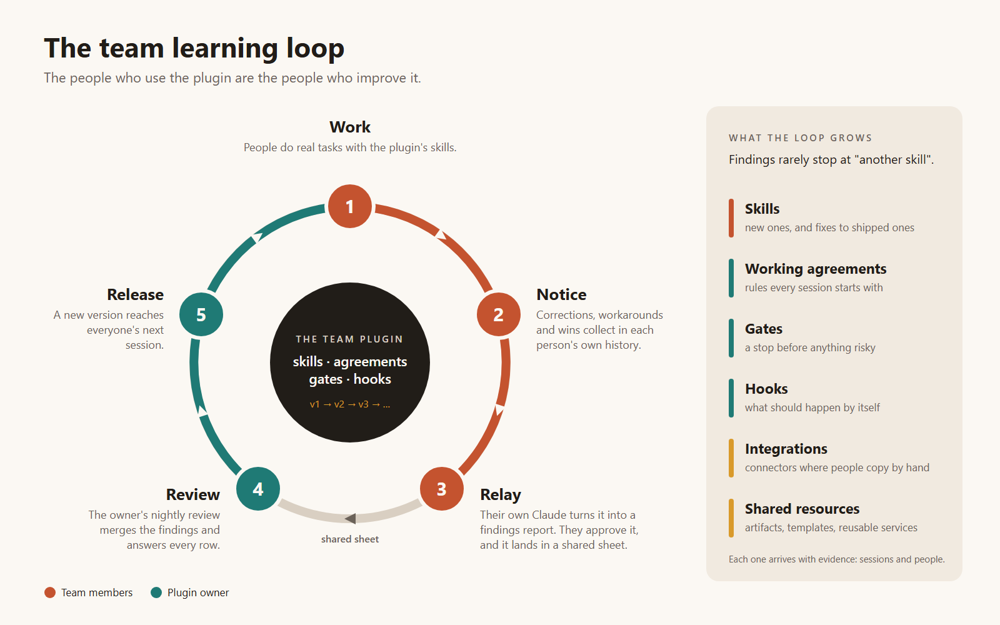
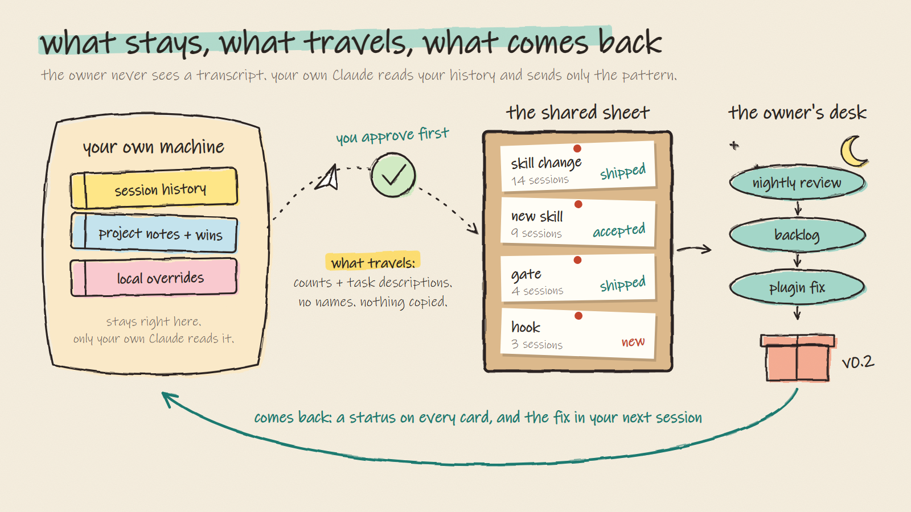
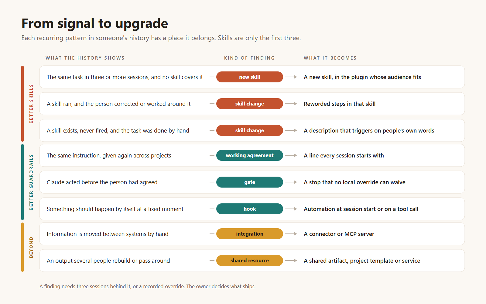

# The plugin that learns from the people who use it

Most teams roll out Claude the same way: someone writes a few skills, shares them, then guesses what to build next. We run a Claude Team plan for a mixed group of consultants and developers, and we wanted to stop guessing. So the plugin our colleagues work with now collects its own improvement requests, with evidence, and a nightly review turns them into the next version.

## The setup

**One plugin for everyone, in the organisation's plugin library.** It holds skills for everyday work (pick up a project, close out a session, write an update), a short list of working agreements printed at session start, and gates: steps where Claude must stop and ask. It runs in chat, Cowork and Claude Code, so nobody needs Git or a terminal. Specialist plugins sit beside it.

**Two feedback skills ship inside that same plugin.**

- `adapt-skill` runs when someone says "here we do it differently". It records a local override that survives updates and, when the fix belongs to everyone, drafts a note for the owner.
- `ideas` has a person's own Claude read their own history: tasks they repeat, instructions they keep giving, corrections they keep making. It compares that with what the plugins already do and writes a findings report.

**One shared sheet is the intake.** Once the person approves, their Claude appends the report as rows: kind, target, evidence, proposal. The sheet also lists every plugin and skill, so `ideas` can tell someone that a plugin they never installed already covers their work.

**A scheduled review closes the loop.** Each night the owner's Claude reads the new rows, merges them into a backlog counted in people and sessions, and drafts the changes on a branch. The owner decides what ships. Every row gets a status, so people see what became of their proposal, and the fix arrives in their next session.

## Why it holds up

**Nothing sensitive travels.** A Team plan gives the owner no view of members' sessions, and we would not want one. Transcripts stay on each person's machine. Only counts and task-level descriptions leave, after the person has read them.

**It costs people nothing while they work.** Nobody keeps a log. The evidence already sits in their history; a skill reads it when asked.

**Evidence replaces opinion.** A request arrives as "this recurred in 14 sessions", not "it would be nice if".

**It needs no admin rights.** On Team, members can publish plugins to the organisation, so the whole loop runs on ordinary accounts.

## More than skills

A report is not a wish list for more skills. Every finding has a kind, and the kind says where it lands. An instruction repeated across projects becomes a working agreement. "Claude went ahead before I agreed" becomes a gate. Something that should happen by itself becomes a hook. Copying between two systems by hand points at a connector; an output several people rebuild points at a shared artifact, a template or a reusable service.

That is the part worth the effort. The loop does not only make prompts better. It shows where Claude fits in the business, with numbers behind each answer.

We are early. The plugins and the sheet are live, and colleagues' first reports are what we watch next.

## Take it

The repository holds the plugin, the owner's review skill, the sheet layout and a setup guide: **github.com/sevenevesai/claude-team-loop**

Point your Claude at its README and ask it to set the loop up for your team.
